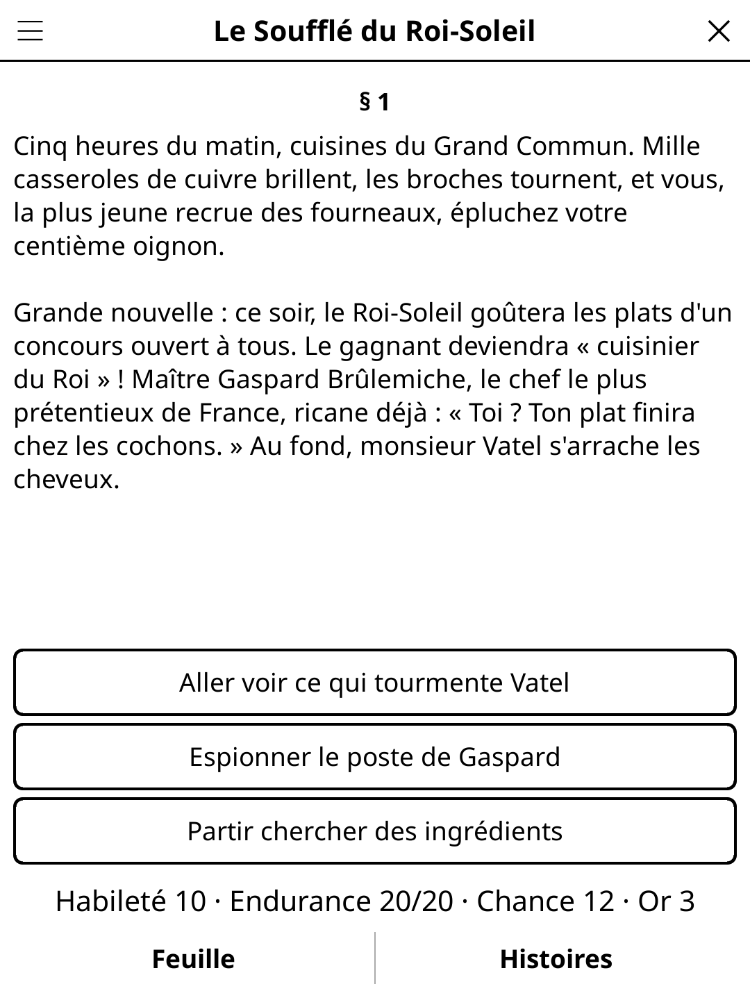

# gamebook.koplugin

**Gamebooks** (*Livres-jeux*, the "choose your own adventure" books) for
[KOReader](https://github.com/koreader/koreader): read a numbered section, pick
what you do next from big buttons, keep a character sheet, fight, test your
luck — and start again when it all goes wrong.

## Screenshot



## Features

- **Twelve bundled adventures**, six in French and six in English (not
  translations of each other — each language has its own stories).
- **Choices as big buttons** under the text. A choice you can't take yet
  ("If you have the key…") is shown greyed out with what it needs.
- **Character sheet** (optional, per story): Skill, Stamina and Luck rolled at
  the start, gold and an inventory. Tap *Sheet* to see it (a page of its
  own, closed with *Close*).
- **Dice**: two-dice combat rounds, skill and luck tests, plain die rolls.
- **Automatic save**: every story keeps its own progress. Switch stories and
  come back later; you resume where you stopped.
- **Forgiving mode** (off by default): adds a *Back* button that undoes the
  last step (up to 40 steps), even after a death, and lets you return to your
  own bookmarks.
- **Bookmarks**: mark the current section (up to 5 per story) and return to it
  later in forgiving mode.
- **Your own stories**: drop a `.lua` file in `koreader/data/gamebook/` (see
  the format below).
- Interface in English, French, Spanish and German (follows KOReader's
  language). The *Language* setting picks which stories are listed.

## Multiplayer

*Gamebooks · multiplayer* (Tools → Games → Party & quiz, or menu → *Mode*):
one player reads aloud, the table decides.

- 2 to 8 players, names typed once and remembered. The heading shows who
  reads ("§ 12 · Reader: Alice"); the book passes to the next player after
  every section, or every 2, 3 or 5 (*Reader changes*). *Next reader* passes
  it by hand.
- **Vote** (on by default): at a choice the reader taps each option once per
  raised hand; *Decide* takes the majority. A tie, or no vote, lets the reader
  decide. *Clear votes* starts again. With Vote off, a tap takes the choice.
- Dice and fights are rolled by the reader ("Rolled by Alice"). No scores:
  the table wins or loses together. Multiplayer adventures are saved apart
  from solo ones.

## Rules

- Read the section and tap a choice. Some choices need an item, a clue you
  found earlier (a *flag*) or some gold (the gold is spent).
- **Fight**: each round you and the enemy roll two dice and add your Skill.
  The higher total wounds the other for 2 Stamina; a tie wounds nobody.
  Bring the enemy to 0 to win. Some fights let you flee (you lose 2 Stamina).
- **Test your Skill**: roll two dice; at or under your Skill succeeds.
- **Test your Luck**: same with your Luck, but every test costs 1 Luck point.
- Stamina at 0 means death. Some stories also have bad endings. Either way,
  *Start again* rolls a new character and goes back to the first section.

## Story format

A story is a Lua file that returns one table. Put it in
`koreader/data/gamebook/` (or the plugin's `stories/` folder). It appears in
the story list for its `lang` (or in every language if there is none).

```lua
return {
    title       = "The Clockwork Tower",
    author      = "You",
    lang        = "en",          -- "en", "fr"... (optional)
    blurb       = "One line shown in the story list.",
    sheet       = true,          -- roll Skill/Stamina/Luck (needed for fights and tests)
    start       = 1,             -- first section (default 1)
    start_gold  = 5,
    start_items = { "lamp" },
    items = {                    -- every item id used, with its display name
        lamp = "Oil lamp",
        key  = "Brass key",
    },
    sections = {
        [1] = {
            text = "You stand at the foot of the tower. A door, a window.",
            choices = {
                { text = "Try the door",            to = 2 },
                { text = "Unlock it with the key",  to = 3, need = "key" },
                { text = "Bribe the guard (3 gold)", to = 4, cost = 3 },
                { text = "Climb in by the window",  to = 5, without = "lamp" },
                { text = "Ask the guard about the clock", to = 6, flag = "met_owl" },
                { text = "A secret choice",         to = 7, flag = "secret", hide = true },
            },
        },
        [2] = { text = "A guard!", fight = { name = "Guard", skill = 7, stamina = 6, win = 8, flee = 1 } },
        [3] = { text = "A pit opens.", test = { stat = "luck", win = 9, lose = 10 } },
        [4] = { text = "The lift creaks.", roll = { dice = 1, outcomes = {
                    { upto = 2, to = 11 }, { upto = 6, to = 12 } } } },
        [5] = { text = "You find a key and 4 gold.", gain = "key", gold = 4, set = "found_key",
                choices = { { text = "Go back", to = 1 } } },
        [9] = { text = "You reach the top. The end!", ending = "win" },
        [10] = { text = "You fall.", ending = "death" },
        -- ...
    },
}
```

Each section has a `text` and **exactly one** way out:

| field | meaning |
|---|---|
| `choices = { {text=, to=, ...}, ... }` | buttons. Optional conditions: `need` (item or list of items), `without` (item), `flag` / `noflag` (flag or list), `cost` (gold, spent when chosen). `hide = true` hides the choice instead of greying it out when it is not available. |
| `fight = { name=, skill=, stamina=, win=, flee= }` | one enemy; or `fight = { enemies = { {name=, skill=, stamina=}, ... }, win=, flee= }` to fight several one after the other. `flee` is optional. Losing is death. |
| `test = { stat = "skill"\|"luck"\|"stamina", win=, lose= }` | roll 2d6, at or under the stat wins. A luck test costs 1 Luck. |
| `roll = { dice = 1\|2, outcomes = { {upto=, to=}, ... } }` | the first outcome whose `upto` is at or above the roll is taken; the last must cover the maximum. |
| `ending = "win"\|"death"\|"end"` | the adventure is over (`end` = neither won nor lost). |

Effects, applied the **first** time the reader enters the section:
`gain` / `lose` (item or list), `set` / `unset` (flag or list), `gold`
(+/−), `skill`, `stamina`, `luck` (+/−, never above the starting value).
Stamina falling to 0 is death.

The plugin checks a story when it loads it and lists the problems instead of
playing it. The spec `test_stories_spec.lua` goes further (every section and
every ending reachable, no dead end given items, flags and gold) — run it on
your own story with `busted test_stories_spec.lua` after copying it into
`stories/`.

## Installation

Copy `gamebook.koplugin/` (with the `common/` folder from `game-common`) into
KOReader's `plugins/` folder. Start it from the Tools menu → *Gamebooks*.

## License

GPL-3.0 — see [LICENSE](LICENSE).
